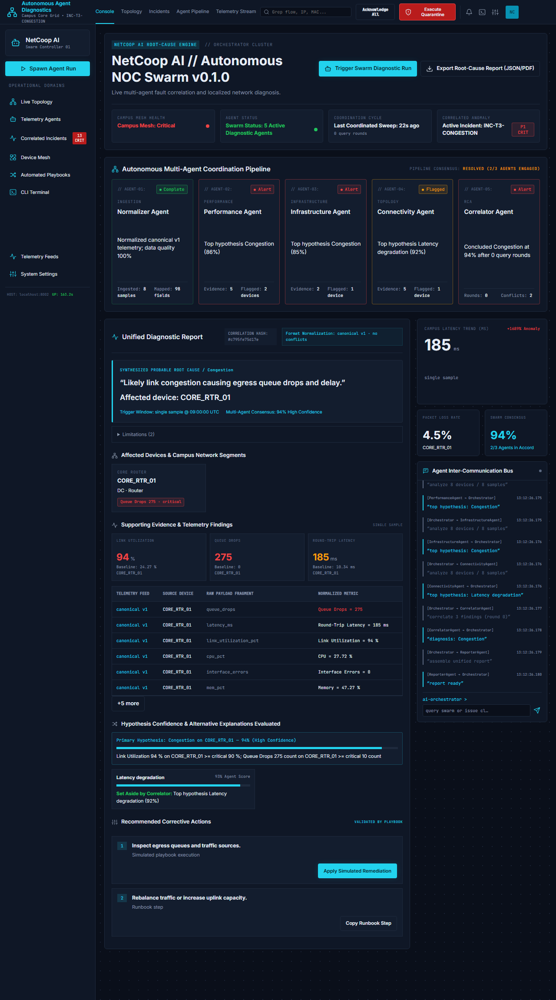
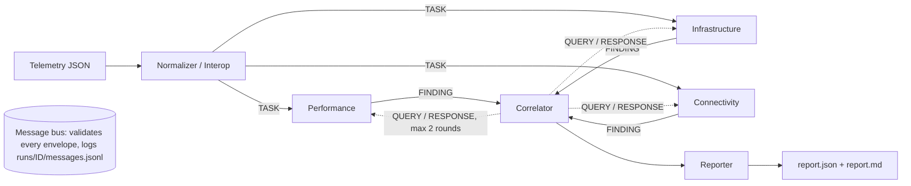
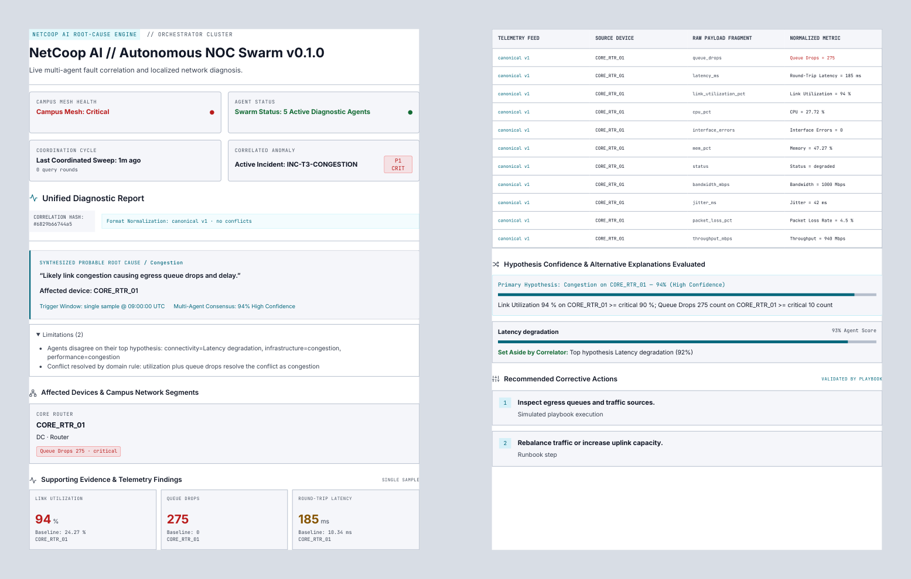

# NetCoop AI — Multi-Agent Network Fault Diagnosis and Interoperability

TechZephyr 4.0 Agentic AI Hackathon entry. Specialised agents analyse synthetic campus-network telemetry, exchange structured messages over a documented protocol, and produce one evidence-based diagnostic report. When the data does not support a diagnosis the system says **insufficient evidence** instead of guessing.

**Live console:** https://netcoop-ai.vercel.app (API on Render free tier: the first request after idle can take up to ~50 s while the backend wakes; the page shows a "Waking diagnostic backend…" banner meanwhile)
**Demo video (3–5 min):** _link added at submission_
**Repo:** https://github.com/sohan1611/NetCoop-AI



## Problem
Campus network faults (congestion, weak Wi-Fi, failing interfaces, overloaded devices, DNS/DHCP outages) show up as overlapping symptoms in telemetry that arrives in inconsistent formats. NetCoop AI normalises the data, lets agents inspect it from different angles, resolves their disagreements, and reports root cause, affected devices, evidence, alternatives, confidence and corrective actions (simulated only).

## Architecture


| Agent | Responsibility |
|---|---|
| Normalizer / Interop | Validates input, maps field aliases, converts units, upgrades old schema versions, flags missing/stale/out-of-range/duplicate values, scores data quality. Accepts the organizer's generator format. |
| Performance | Latency, jitter, loss, throughput, utilization, RSSI, retransmissions vs. thresholds and baselines. |
| Infrastructure | Device status, CPU/memory, interface errors, queue drops. |
| Connectivity | Topology graph (networkx): common upstream device, blast radius, isolated segments, DNS/DHCP health. |
| Correlator | Scores competing hypotheses using all findings, resolves conflicts, sends QUERY messages for more data when unsure. |
| Reporter | Final JSON + Markdown report, playbook actions, optional LLM narrative (never changes cause or confidence). |

Orchestrator: per-agent timeout (10 s) and one retry; a failed agent is skipped and recorded as a limitation. State is checkpointed after each stage so a run can be resumed. Full design: [docs/PLAN.md](docs/PLAN.md).

## Agent protocol
JSON envelope `{msg_id, schema_version, type, sender, recipient, correlation_id, timestamp, payload}` with types `TASK`, `FINDING`, `QUERY`, `RESPONSE`, `ERROR`. Every field, unit and an example per type: [docs/PROTOCOL.md](docs/PROTOCOL.md). Models are pydantic v2 (`netcoop/protocol.py`); invalid messages are rejected into ERROR envelopes, never crash the run.

## Confidence method
`match = Σ wᵢ·mᵢ / Σ wᵢ` (graded 0–1 match of each signature metric), `coverage` = share of signature metrics present,
`confidence = match × (0.5 + 0.5·coverage) × data_quality × agreement`.
Categories: ≥0.75 high, 0.5–0.75 medium, 0.3–0.5 low, below 0.3 → `insufficient_evidence`. If confidence < 0.5 or the top-2 margin < 0.15 the correlator queries agents (widen window, upstream neighbours, device detail) up to 2 rounds.

## Output format
`incident_id`, `status`, `suspected_root_cause`, `confidence`, `affected_devices`, `supporting_evidence`, `alternative_causes`, `recommended_actions`, `evidence_sources`, `limitations`, plus `confidence_category` and `run_id`.

## Error handling
Malformed JSON, missing sections, unknown fields, legacy schemas, unit mismatches, a crashed or slow agent, and invalid bus messages all produce a clear `error` / limitation entry rather than an exception. If the correlator or reporter fails the orchestrator still returns a valid degraded `insufficient_evidence` report built from the analysis findings. Numeric strings (`"99.9%"`), CamelCase field names, `{"records": [...]}` wrappers and organizer records without `device_id` are accepted with a data-quality note; impossible values (pct outside 0–100, negative counts or latency, RSSI > 0) are quarantined and itemized, never analysed; samples older than collected_at − 1 h or newer than collected_at + 5 min are quarantined; same-instant rows are merged and conflicting aliases or duplicate devices are flagged instead of silently picking one. Inject a failure with `--fail-agent infrastructure`.

## Setup
Requires Python 3.11+ (developed on 3.14).
```bash
python -m venv .venv && . .venv/bin/activate   # Windows: .venv\Scripts\activate
pip install -e ".[dev]"
cp .env.example .env    # optional: GEMINI_API_KEY / GEMINI_MODEL
```
Everything runs offline with `--no-llm`; Gemini is optional (used only to map unknown fields and write a narrative).

## Run
```bash
python -m netcoop diagnose data/scenarios/congestion.json --no-llm --md
python -m netcoop diagnose data/scenarios/congestion.json --no-llm --fail-agent infrastructure
python -m netcoop evaluate --no-llm
python -m netcoop resume <run_id>
python -m netcoop remediate <run_id> --approve     # simulated fix, re-diagnose, verified true/false
uvicorn api.server:app                              # dashboard at http://127.0.0.1:8000
python mcp_server.py                                # optional MCP server (pip install -e ".[mcp]")
```
MCP tools: `list_scenarios`, `get_telemetry`, `diagnose`.

### Console UI
Open http://127.0.0.1:8000 (or the live link above). Everything on the page comes from the API; nothing is hard-coded.
- **Run:** *Trigger Swarm Diagnostic Run* runs the selected scenario (default `congestion`). *Spawn Agent Run* opens the run modal: pick a scenario or upload your own telemetry JSON (canonical, legacy v0 or the organizer's format), and optionally kill an agent (`fail infrastructure`, etc.) to watch the run degrade gracefully.
- **Console view:** hero status cards, the 5-agent coordination pipeline with live status pills, the unified report (root cause, affected devices, evidence tiles with baselines, raw → normalized telemetry mapping, primary and alternative hypotheses, limitations, playbook actions), latency/loss/consensus cards, and the live agent message bus (SSE).
- **Other views:** Topology (affected nodes red, upstream root amber; click a node for its metrics), Incidents (all runs; click one to reopen it), Agent Pipeline (messages per agent), Telemetry Stream (full bus + normalized samples), Device Mesh, Automated Playbooks, CLI Terminal (type `help`), Telemetry Feeds / System Settings (API limits).
- **Simulated fix:** *Apply Simulated Remediation* patches a copy of the telemetry, re-diagnoses and shows before → after with `verified: true/false`. Nothing touches real infrastructure.
- **Export:** JSON (`/api/runs/<id>/report`), Markdown (`/report.md`) or *Print / Save PDF*, which uses a light print stylesheet that lists every telemetry row and the limitations.
- **Share a run:** `/?run=<run_id>` opens a finished run directly.
- Works down to 375 px wide (mobile tabs, no horizontal scroll).



## Tests
```bash
pytest -q
python scripts/evaluate.py
```
`evaluate` runs every labelled scenario and prints expected vs. got, confidence and pass/fail. Current results: **247 tests pass** with `pip install -e ".[dev,mcp]"` (with only `.[dev]` the MCP tests are skipped), **evaluate 16/16**. `python scripts/stress_test.py` and `python scripts/hostile_inputs.py` throw malformed, hostile and oversized inputs at the pipeline and report any crash (none today). The full 117-check QA matrix (`docs/qa/TEST_MATRIX.md`, defects in `docs/QA_TRACKER.md`) was executed and passes; `PYTHONPATH=. python scripts/run_local_qa.py` replays the adversarial fixtures.

## Submission checklist (problem statement §7)
| Deliverable | Where |
|---|---|
| Source code (GitHub repo) | this repository: `netcoop/` (agents, bus, orchestrator), `api/` (FastAPI + console UI), `mcp_server.py` |
| Demo video, 3–5 min | link at the top; script in [docs/DEMO_SCRIPT.md](docs/DEMO_SCRIPT.md) |
| README / architecture docs | this file, [docs/PLAN.md](docs/PLAN.md) (design), [docs/PROTOCOL.md](docs/PROTOCOL.md) (agent messages), [docs/UI_PLAN.md](docs/UI_PLAN.md) (console) |
| Sample data | `data/scenarios/*.json` (16 scenarios incl. organizer format) + `labels.json` |
| Test cases | `tests/` (pytest), `scripts/evaluate.py`, `scripts/stress_test.py`, `scripts/hostile_inputs.py` |
| Runnable prototype | `python -m netcoop diagnose …` (CLI), `uvicorn api.server:app` (console), live link above |
| Structured report (JSON) | `runs/<id>/report.json` and `GET /api/runs/<id>/report`; fields under *Output format* |

## Scenarios
In `data/scenarios/` (regenerate with `python scripts/gen_scenarios.py`): normal, congestion, weak_wifi, interface_fault, device_overload, dns_failure, dhcp_failure, interop_renamed_fields_units, schema_v0_legacy, missing_sections, malformed_json, conflicting_evidence, insufficient_data, and the organizer-format files `org_normal`, `org_latency_spike`, `org_hardware_failure`. Expected causes are in `labels.json`.

## Security & robustness
- **Privacy:** each browser gets an HttpOnly session cookie and only sees its own runs and uploads (other sessions get 404 for list, stream, report, details, topology and remediate); the event stream redacts raw input. Run IDs are not secrets, so this is a demo deployment: do not upload real campus data.
- **Resource limits:** at most 2 concurrent runs and 10 runs per minute per IP (HTTP 429 beyond that); uploads are capped at 5 MB per file (413, enforced while streaming), 20 files / 25 MB in total, and rate-limited per IP; inputs over 25,000 devices, 50,000 samples, 200 nodes, 1,000 links or 200 services return an `input too large` error. Runs execute in worker threads so the API and SSE streams stay responsive.
- **Cleanup:** run and upload folders (and finished task records) older than `NETCOOP_RUN_TTL_S` seconds (default 3600) are deleted on each new run.
- **Errors:** API responses use generic wording ("JSON nesting too deep", "number too large", "invalid JSON telemetry"); exception detail goes to server logs only.
- **Headers:** `nosniff`, `X-Frame-Options: DENY`, `Referrer-Policy: no-referrer` and a CSP are set on every response; the cytoscape CDN script is pinned with an SRI hash.
- **Diagnosis robustness:** alternatives that score higher than the chosen cause are kept and marked `overruled_by` the domain rule (never hidden); an unresolved agent conflict lists the leading hypotheses and reports insufficient evidence; `normal` is ineligible while any device is `down` or any metric is critical, and a down device is diagnosed as `hardware_failure` (or `interface_fault` when interface errors dominate) even without topology; the connectivity agent abstains when no topology or services are supplied; `NaN`/`Infinity`/`1e999` values are dropped as invalid. Checked by `scripts/stress_test.py` and `scripts/hostile_inputs.py` (no crashes; 20,000 healthy devices with a full metric set diagnose as `normal` in about 2 s).
- **Single worker:** run state is held in process memory, so deploy with exactly one uvicorn worker (`uvicorn api.server:app --host 0.0.0.0 --port $PORT`, no `--workers`).

## Limitations
Synthetic data only; remediation is simulated and touches nothing real; signatures are rule-based and tuned for the campus topology in the scenarios; Gemini output is advisory only.

## Acknowledgements
Dashboard icons use inline [Lucide](https://lucide.dev/) SVG paths, licensed under the ISC licence.

Python, pydantic, FastAPI, uvicorn, networkx, cytoscape.js (CDN, dashboard), google-genai (optional), python-dotenv, pytest, and the Model Context Protocol Python SDK (optional). Mock-data format from the hackathon organizers.
