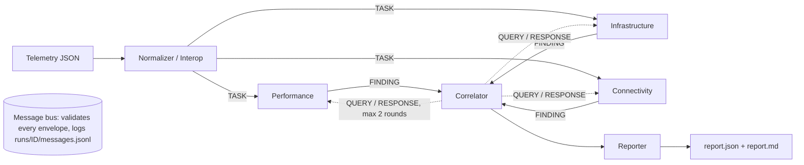

# NetCoop AI — Multi-Agent Network Fault Diagnosis and Interoperability

TechZephyr 4.0 Agentic AI Hackathon entry. Specialised agents analyse synthetic campus-network telemetry, exchange structured messages over a documented protocol, and produce one evidence-based diagnostic report. When the data does not support a diagnosis the system says **insufficient evidence** instead of guessing.

## Problem
Campus network faults (congestion, weak Wi-Fi, failing interfaces, overloaded devices, DNS/DHCP outages) show up as overlapping symptoms in telemetry that arrives in inconsistent formats. NetCoop AI normalises the data, lets agents inspect it from different angles, resolves their disagreements, and reports root cause, affected devices, evidence, alternatives, confidence and corrective actions (simulated only).

## Architecture


| Agent | Responsibility |
|---|---|
| Normalizer / Interop | Validates input, maps field aliases, converts units, upgrades old schema versions, flags missing/stale/out-of-range/duplicate values, scores data quality. Accepts the organizer's generator format. |
| Performance | Latency, jitter, loss, throughput, utilization, RSSI, retransmissions vs. thresholds and baselines. |
| Infrastructure | Device status, CPU/memory, interface errors, queue drops. |
| Connectivity | Topology graph (networkx): common upstream device, blast radius, isolated segments, DNS/DHCP health. |
| Correlator | Scores competing hypotheses using all findings, resolves conflicts, sends QUERY messages for more data when unsure. |
| Reporter | Final JSON + Markdown report, playbook actions, optional LLM narrative (never changes cause or confidence). |

Orchestrator: per-agent timeout (10 s) and one retry; a failed agent is skipped and recorded as a limitation. State is checkpointed after each stage so a run can be resumed. Full design: [docs/PLAN.md](docs/PLAN.md).

## Agent protocol
JSON envelope `{msg_id, schema_version, type, sender, recipient, correlation_id, timestamp, payload}` with types `TASK`, `FINDING`, `QUERY`, `RESPONSE`, `ERROR`. Every field, unit and an example per type: [docs/PROTOCOL.md](docs/PROTOCOL.md). Models are pydantic v2 (`netcoop/protocol.py`); invalid messages are rejected into ERROR envelopes, never crash the run.

## Confidence method
`match = Σ wᵢ·mᵢ / Σ wᵢ` (graded 0–1 match of each signature metric), `coverage` = share of signature metrics present,
`confidence = match × (0.5 + 0.5·coverage) × data_quality × agreement`.
Categories: ≥0.75 high, 0.5–0.75 medium, 0.3–0.5 low, below 0.3 → `insufficient_evidence`. If confidence < 0.5 or the top-2 margin < 0.15 the correlator queries agents (widen window, upstream neighbours, device detail) up to 2 rounds.

## Output format
`incident_id`, `status`, `suspected_root_cause`, `confidence`, `affected_devices`, `supporting_evidence`, `alternative_causes`, `recommended_actions`, `evidence_sources`, `limitations`, plus `confidence_category` and `run_id`.

## Error handling
Malformed JSON, missing sections, unknown fields, legacy schemas, unit mismatches, a crashed or slow agent, and invalid bus messages all produce a clear `error` / limitation entry rather than an exception. If the correlator or reporter fails the orchestrator still returns a valid degraded `insufficient_evidence` report built from the analysis findings. Numeric strings (`"99.9%"`), CamelCase field names, `{"records": [...]}` wrappers and organizer records without `device_id` are accepted with a data-quality note; impossible values (latency > 60000 ms, counts > 1e9, pct > 100) are flagged out-of-range. Inject a failure with `--fail-agent infrastructure`.

## Setup
Requires Python 3.11+ (developed on 3.14).
```bash
python -m venv .venv && . .venv/bin/activate   # Windows: .venv\Scripts\activate
pip install -e ".[dev]"
cp .env.example .env    # optional: GEMINI_API_KEY / GEMINI_MODEL
```
Everything runs offline with `--no-llm`; Gemini is optional (used only to map unknown fields and write a narrative).

## Run
```bash
python -m netcoop diagnose data/scenarios/congestion.json --no-llm --md
python -m netcoop diagnose data/scenarios/congestion.json --no-llm --fail-agent infrastructure
python -m netcoop evaluate --no-llm
python -m netcoop resume <run_id>
python -m netcoop remediate <run_id> --approve     # simulated fix, re-diagnose, verified true/false
uvicorn api.server:app                              # dashboard at http://127.0.0.1:8000
python mcp_server.py                                # optional MCP server (pip install -e ".[mcp]")
```
Dashboard: pick or upload a scenario, watch live agent messages, see the topology with affected nodes highlighted, read the report, and approve the simulated fix. MCP tools: `list_scenarios`, `get_telemetry`, `diagnose`.

## Tests
```bash
pytest -q
python scripts/evaluate.py
```
`evaluate` runs every labelled scenario and prints expected vs. got, confidence and pass/fail.

## Scenarios
In `data/scenarios/` (regenerate with `python scripts/gen_scenarios.py`): normal, congestion, weak_wifi, interface_fault, device_overload, dns_failure, dhcp_failure, interop_renamed_fields_units, schema_v0_legacy, missing_sections, malformed_json, conflicting_evidence, insufficient_data, and the organizer-format files `org_normal`, `org_latency_spike`, `org_hardware_failure`. Expected causes are in `labels.json`.

## Limitations
Synthetic data only; remediation is simulated and touches nothing real; signatures are rule-based and tuned for the campus topology in the scenarios; Gemini output is advisory only.

## Acknowledgements
Python, pydantic, FastAPI, uvicorn, networkx, cytoscape.js (CDN, dashboard), google-genai (optional), python-dotenv, pytest, and the Model Context Protocol Python SDK (optional). Mock-data format from the hackathon organizers.
